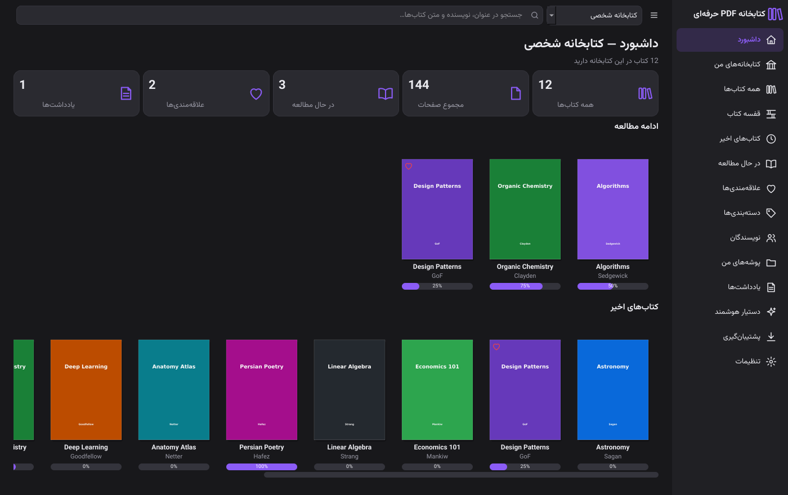
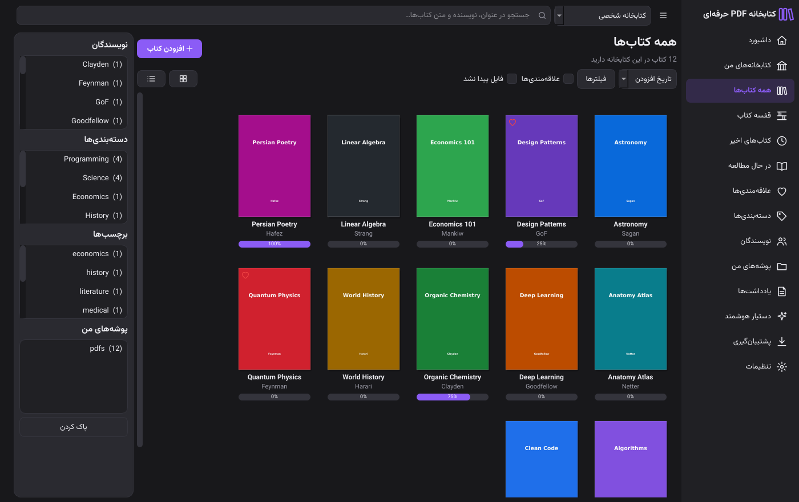
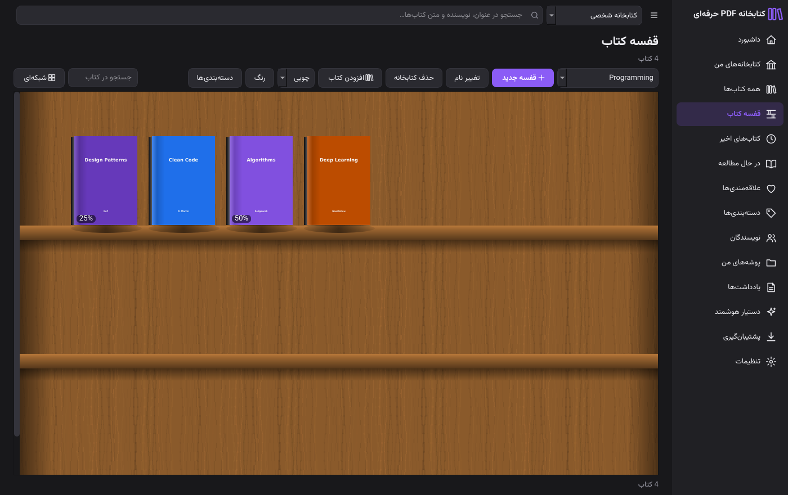
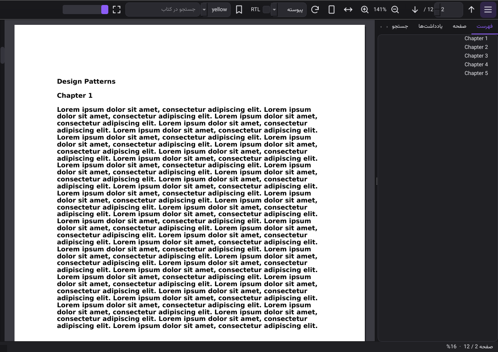
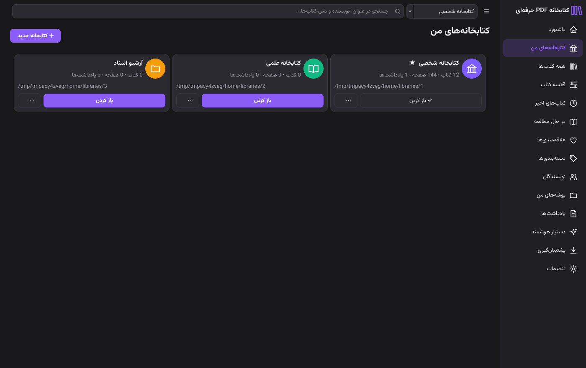

# کتابخانه PDF حرفه‌ای (PDF Library Pro)

برنامه دسکتاپ ویندوز برای مدیریت، مطالعه، جستجو و تحلیل فایل‌های PDF شخصی — با قفسه کتاب، چند کتابخانه مستقل، یادداشت‌برداری، OCR اختیاری و دستیار هوش مصنوعی اختیاری.



> تصاویر این راهنما از اجرای واقعی خود برنامه گرفته شده‌اند (با PDFهای نمونه).

## امکانات

- **ویندوز ۱۰ و ۱۱ (۶۴ بیتی)**، فایل مستقل `PDFLibraryPro.exe` و نصب‌کننده `PDFLibraryPro-Setup.exe` — بدون نیاز به نصب Python
- رابط فارسی و انگلیسی، RTL واقعی، تم روشن/تاریک و رنگ اصلی قابل انتخاب، فونت Vazirmatn، منوی کناری قابل جمع‌شدن
- نمای **شبکه‌ای (Grid)**، **لیستی (List)** و **قفسه (Bookshelf)**
- افزودن تکی/گروهی/پوشه کامل، Drag & Drop، تشخیص تکراری با SHA-256، استخراج خودکار عنوان و جلد
- ویرایش نویسنده، مترجم، ناشر، دسته‌بندی، برچسب، توضیحات، جلد دستی؛ مرتب‌سازی و فیلتر ترکیبی
- حذف از کتابخانه **بدون حذف فایل اصلی**؛ حذف واقعی فایل فقط با تأیید صریح
- کپی/انتقال فایل به آرشیو داخلی (اختیاری) و بازیابی مسیر فایل جابه‌جا‌شده (با SHA-256)
- **خواننده PDF داخلی**: تک‌صفحه، دوصفحه، پیوسته، تمام‌صفحه، زوم، عرض/کل صفحه، چرخش، رفتن به صفحه، جستجو، انتخاب و کپی متن، فهرست، ذخیره خودکار آخرین صفحه و درصد پیشرفت
- **نشان‌گذاری، هایلایت رنگی، یادداشت صفحه، ذخیره نقل‌قول، خروجی Markdown**
- **جستجوی پیشرفته** با SQLite FTS5: عنوان، نام فایل، نویسنده، مترجم، ناشر، دسته‌بندی، برچسب، متن PDF و یادداشت‌ها؛ نرمال‌سازی «ی/ي» و «ک/ك» و اعداد فارسی؛ پیشنهاد هنگام تایپ؛ نمایش شماره صفحه و بازکردن مستقیم صفحه
- **چند کتابخانه مستقل** (هرکدام پایگاه داده جدا)، رنگ/آیکون/مسیر دلخواه، کتابخانه پیش‌فرض، قفل اختیاری با رمز، انتقال کتاب بین کتابخانه‌ها با حفظ یادداشت‌ها، نشان‌ها، هایلایت‌ها و پیشرفت مطالعه
- **قفسه کتاب**: جلد واقعی، ظاهر چوبی/مدرن، تغییر رنگ، قفسه با نام دلخواه، چیدمان خودکار بر اساس دسته‌بندی، جابه‌جایی با کشیدن و رها کردن، ذخیره چیدمان
- **دستیار AI** (اختیاری): پرسش و پاسخ با شماره صفحه منبع، خلاصه کتاب/فصل/صفحات، نکات مهم، تعاریف، فلش‌کارت، آزمون چهارگزینه‌ای، مقایسه کتاب‌ها، موضوعات، جزوه، پرسش از چند کتاب، ذخیره گفتگوها و خروجی
- **OCR** (اختیاری، با Tesseract) برای صفحات اسکن‌شده
- **پشتیبان‌گیری و بازیابی** ZIP با زمان‌بندی؛ بازیابی همیشه به‌صورت کتابخانه جدید انجام می‌شود تا داده‌ای بازنویسی نشود

## اسکرین‌شات‌ها

| همه کتاب‌ها | قفسه |
|---|---|
|  |  |

| خواننده PDF | کتابخانه‌ها |
|---|---|
|  |  |

## نصب

۱. از بخش **Releases** همین مخزن فایل `PDFLibraryPro-Setup.exe` را دانلود و اجرا کنید (یا فقط `PDFLibraryPro.exe` را بدون نصب اجرا کنید).
۲. اگر ویندوز هشدار SmartScreen داد: «More info» ← «Run anyway» (برنامه امضای دیجیتال ندارد).
۳. داده‌های شما در `%APPDATA%\PDFLibraryPro` ذخیره می‌شود و با حذف برنامه پاک نمی‌شود.

## افزودن PDF

- دکمه **افزودن کتاب** ← «افزودن کتاب» (چند فایل) یا «افزودن پوشه» (همه PDFهای زیرپوشه‌ها)، یا فایل‌ها را روی پنجره بکشید.
- نحوه افزودن در **تنظیمات ← نحوه افزودن فایل**: فقط پیوند (پیش‌فرض)، کپی در آرشیو داخلی، یا انتقال.
- متن کتاب‌ها در پس‌زمینه ایندکس می‌شود؛ تا پایان آن، جستجوی متن کامل برای آن کتاب کامل نیست (نوار پیشرفت بالای صفحه).
- فایل خراب رد می‌شود و در گزارش پایان افزودن نشان داده می‌شود. فایل رمزدار اضافه می‌شود و هنگام باز کردن رمز پرسیده می‌شود.
- راست‌کلیک روی کتاب: ویرایش مشخصات، علاقه‌مندی، افزودن به قفسه، انتقال به کتابخانه دیگر، حذف از کتابخانه، حذف فایل از دیسک.

## ساخت کتابخانه

بخش **کتابخانه‌های من** ← «کتابخانه جدید». مسیر ذخیره‌سازی اختیاری است. از منوی «⋯» هر کارت: تغییر نام، رنگ، آیکون، پیش‌فرض، قفل با رمز، پشتیبان‌گیری، حذف (فایل‌های PDF اصلی شما حذف نمی‌شوند). برای انتقال کتاب: راست‌کلیک ← «انتقال به کتابخانه دیگر».

## ساخت قفسه

بخش **قفسه کتاب** ← «قفسه جدید» ← «افزودن کتاب». دکمه «دسته‌بندی‌ها» برای هر دسته یک قفسه می‌سازد. کتاب‌ها را بکشید و رها کنید تا ترتیب ذخیره شود؛ دابل‌کلیک کتاب را باز می‌کند. دکمه «شبکه‌ای» نمای جایگزین Grid را نشان می‌دهد.

## استفاده از AI

**تنظیمات ← حالت هوش مصنوعی**: «بدون AI»، «محلی (Ollama)» یا «API». سپس در **دستیار هوشمند** یک یا چند کتاب را انتخاب، نوع کار را برگزینید و «اجرا» بزنید. پاسخ‌ها فقط از متن PDF ساخته می‌شوند و شماره صفحه منبع (قابل کلیک) دارند. اگر پاسخ در PDF نباشد، برنامه صراحتاً می‌گوید «پیدا نشد» و اصلاً مدل را صدا نمی‌زند.

- بازیابی متن: جستجوی BM25 روی قطعات متن (با حفظ شماره صفحه) — Embedding معنایی در این نسخه پیاده‌سازی نشده است.
- کتاب‌های اسکن‌شده تا اجرای OCR متنی ندارند و دستیار از آن‌ها پاسخی نمی‌دهد.

### Ollama (محلی، بدون ارسال داده به اینترنت)
راهنمای کامل: [docs/OLLAMA.md](docs/OLLAMA.md).

### API
آدرس سرویس سازگار با OpenAI (مثلاً `https://api.openai.com/v1`)، نام مدل و کلید را وارد کنید. کلید در ویندوز با DPAPI رمزگذاری می‌شود و هرگز در دیتابیس یا GitHub قرار نمی‌گیرد. قبل از اولین ارسال، برنامه رضایت شما را برای ارسال قطعات متن PDF می‌پرسد؛ سقف طول هر پاسخ (max tokens) قابل تنظیم است و مجموع توکن مصرف‌شده در نوار وضعیت دستیار دیده می‌شود.

## OCR
اختیاری و جدا از برنامه: [docs/OCR.md](docs/OCR.md). فایل اصلی PDF هرگز تغییر نمی‌کند؛ متن استخراج‌شده در دیتابیس ذخیره و جستجو می‌شود.

## Backup و Restore

بخش **پشتیبان‌گیری**: پشتیبان یک کتابخانه یا همه (ZIP شامل دیتابیس، جلدها، تنظیمات، یادداشت‌ها/نشان‌ها به‌صورت JSON و آرشیو داخلی). زمان‌بندی روزانه/هفتگی و پوشه مقصد قابل تنظیم است. «بازیابی» همیشه یک **کتابخانه جدید** می‌سازد و داده فعلی را بازنویسی نمی‌کند.

## رفع خطا

| مشکل | راه‌حل |
|---|---|
| فایل پیدا نشد (قرمز روی جلد) | روی کتاب راست‌کلیک ← «بازیابی مسیر»، فایل یا پوشه جدید را نشان دهید؛ مطابقت با SHA-256 بررسی می‌شود |
| جستجوی متن نتیجه نمی‌دهد | ایندکس کتاب هنوز تمام نشده یا کتاب اسکن‌شده است (OCR) |
| Ollama وصل نمی‌شود | اجرای Ollama و آدرس `http://localhost:11434` را بررسی کنید؛ دکمه ↻ در تنظیمات |
| فایل رمزدار باز نمی‌شود | رمز درست را وارد کنید (۳ بار فرصت) |
| لاگ خطا | `%APPDATA%\PDFLibraryPro\logs\app.log` |

## توسعه

```bash
pip install -r requirements-dev.txt
python -m pytest tests -q          # تست‌ها (روی Linux/Windows با QT_QPA_PLATFORM=offscreen)
python -m app.main                 # اجرا
python scripts/make_screenshots.py docs/screenshots
pyinstaller PDFLibraryPro.spec     # فقط روی ویندوز، ساخت EXE
```

ساخت خودکار EXE و Setup با GitHub Actions: `.github/workflows/build-windows.yml`.

## محدودیت‌های شناخته‌شده

- قفسه با QPainter به‌صورت **۲٫۵ بعدی** (سایه، عمق و دسته‌بندی) رسم می‌شود، نه Qt Quick 3D؛ برای سبک و سازگار ماندن بسته.
- انتخاب متن در خواننده با کشیدن کادر انجام می‌شود (نه انتخاب کلمه‌به‌کلمه).
- هایلایت‌ها روی مختصات صفحه ذخیره می‌شوند و داخل فایل PDF نوشته نمی‌شوند (فایل اصلی دست‌نخورده می‌ماند).
- بازیابی متن AI بر پایه کلمات است، نه Embedding معنایی.
